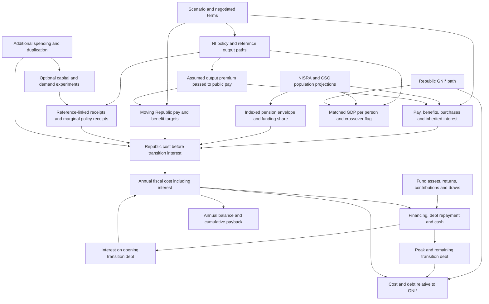

# Current model connections

The component fiscal engine separates reference-linked receipts, public pay, non-pension benefits, pensions and residual purchases. The full description and source limitations are in [the component repair note](component_repair_2026_10_29.md).

The harmonisation input now has upper, middle and lower cases, a separate rate-based welfare candidate and a custom sensitivity. All use explicit pay and welfare gaps and offsets, with no tax recovery inferred from the unreconciled F&M tables.

No central case is selected. The rate-based candidate leaves some benefits and eligibility effects uncosted, and all Doyle-based cases retain an unverified price-basis caveat.
