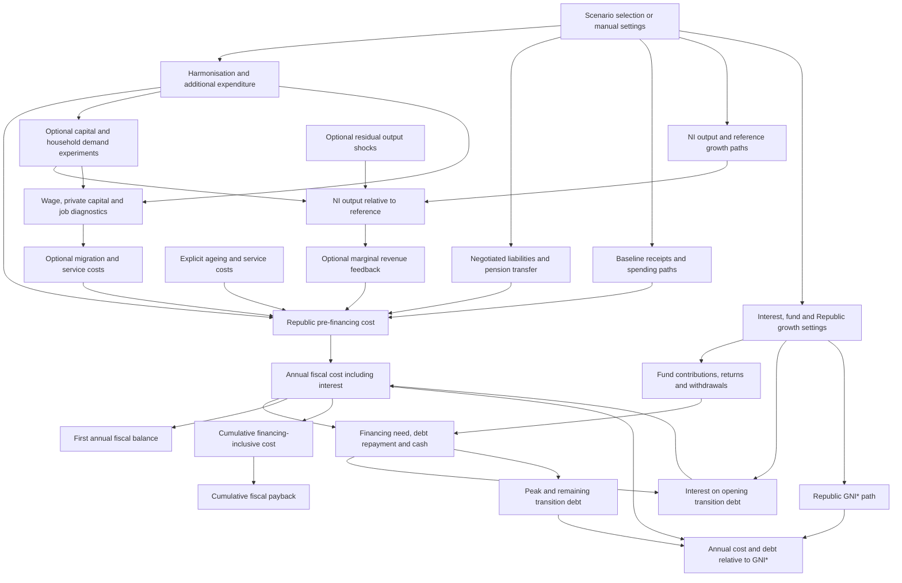

# Reunification Scenarios

The model compares conditional fiscal paths from the Republic of Ireland’s perspective, using separate gross receipts and spending baselines for Northern Ireland. Negotiated deductions, pension funding, inherited interest, harmonisation and additional expenditure are explicit settings, with no negotiated deductions or extra growth revenue assumed in the opening reference case.

Net fiscal harmonisation is separate from source-based gross pay and welfare changes, while pension funding transfers towards the same envelope used for immediate responsibility. Ageing requires an explicit service spending base, and no arbitrary share of the residual deficit is assumed to disappear.

Economic responses are optional experiments rather than estimated causal effects. Only an explicitly selected capital share can produce public capital, the external reduced-form output benchmark is counted once, induced capital and jobs remain diagnostics, and household demand is constrained by selected spare capacity.

Selected revenue feedback connects extra output to fiscal costs only when enabled, while debt, cash and fund assets follow accounting identities. Each run can be downloaded with its settings, comparison policies and executable fingerprint, and the [audit](model_audit_2026_10_28.md) records the evidence still needed for a dated policy costing or welfare analysis.

Private capital and employment diagnostics do not have an additional arrow into output. Optional migration can generate service costs, but its housing, tax and demographic effects remain incomplete.

Sources and exact source-table arithmetic are recorded in [the calibration file](../data/simulator_calibration.json). The current [reference page](../simulator/model_reference.html) lists every registered input, annual engine variable and result field.
